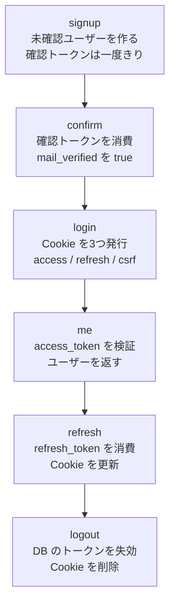

# study-auth

会員登録からログアウトまでを、手元で動かしながら学ぶための小さな認証 API です。
FastAPI と async SQLAlchemy を使っています。画面はありません。`curl` で API を呼び、Cookie やトークンがどう動くかを確認します。

このリポジトリで追える流れは次のとおりです。

1. メールアドレスとパスワードで会員登録する
2. メール確認用 URL を開く
3. ログインして Cookie を受け取る
4. ログイン中のユーザーを取得する
5. トークンを更新する
6. ログアウトする

> [!WARNING]
> これは学習用の実装です。本番の認証基盤として使ったり、他のアプリケーションから依存したりしないでください。

## 先に知っておく5つの言葉

初めから細かい仕様を覚える必要はありません。まずは次のイメージで十分です。

- **JWT** — 中身を読める、署名付きの通行証です。秘密の文字列ではありませんが、書き換えると署名検証に失敗します。
- **アクセストークン** — API を使うときの短命な通行証です。この実装では15分で期限が切れます。
- **リフレッシュトークン** — 新しい通行証を発行してもらうための引換券です。一度使うと無効になり、新しい引換券に交換されます。
- **Cookie** — ブラウザや `curl` が保存し、次のリクエストに付けて送る値です。
- **CSRF** — ログイン中のブラウザに、別サイトから意図しない操作をさせる攻撃です。この実装では Cookie とヘッダの両方に同じ値があることを確認します。

## 準備する

Python 3.11 以上と OpenSSL を使います。リポジトリのルートで実行してください。

```bash
python -m venv .venv
source .venv/bin/activate
pip install -r requirements.txt -r requirements-dev.txt
./scripts/bootstrap_dev_secrets.sh
```

ここまでで、Python の仮想環境、必要なパッケージ、開発用の鍵と設定が用意されます。

`bootstrap_dev_secrets.sh` は次のファイルを作ります。

- `secret/dev_priv.pem` — JWT に署名する秘密鍵
- `secret/dev_pub.pem` — JWT を検証する公開鍵
- `.env` — 鍵の場所、署名用の秘密値、DB の場所など

これらの値を理解してからでないと起動できない、ということはありません。まずはスクリプトに任せて動かしてみてください。ただし、`secret/`、`*.pem`、`.env` は秘密を含むので Git にコミットしません。

`.env` は手で埋める必要はありません。上の `./scripts/bootstrap_dev_secrets.sh` を実行したとき、リポジトリ直下に `.env` が無ければ、スクリプトが新規作成します。中身は次のキーです。

- `JWT_PRIVATE_KEY_PATH` — `secret/dev_priv.pem` の絶対パス
- `JWT_PUBLIC_KEY_PATH` — `secret/dev_pub.pem` の絶対パス
- `SECRET_KEY` — リフレッシュトークンの HMAC 用。`openssl rand` で作る（OpenSSL が無ければ Python の `secrets`）
- `CSRF_SECRET` — CSRF トークンの署名用。同じ方法で作る
- `ACCESS_TOKEN_EXPIRE_MINUTES=15`
- `REFRESH_TOKEN_EXPIRE_DAYS=7`
- `DATABASE_URL` — このリポジトリの `study_auth.db` を指す SQLite の URL

作られた `.env` の権限は `600` です。すでに `.env` があるときは上書きしません。値を入れ直すときは `.env` を削除してから、同じスクリプトをもう一度実行します。`secret/dev_priv.pem` と `secret/dev_pub.pem` は、スクリプトを実行するたびに作り直されます。

キー名だけの見本は [`.env.example`](.env.example) です。値は空なので、これを `.env` にコピーしても秘密は入りません。起動に使うのは、スクリプトが書いた `.env` です。

### サーバを起動する

ターミナルを2つ使います。1つ目でサーバを起動し、そのまま開いておきます。

```bash
source .venv/bin/activate
uvicorn app.main:app --app-dir backend --host 127.0.0.1 --port 8000
```

起動時に DB のテーブルが無ければ自動で作ります。2つ目のターミナルは、次の `curl` コマンドを実行するために使います。

## 手を動かしてみる

以下はすべて、リポジトリのルートで実行します。

### 1. 会員登録する

```bash
curl -i -X POST http://127.0.0.1:8000/api/auth/signup \
  -H 'content-type: application/json' \
  -d '{"email":"learner@example.com","password":"password123","name":"Learner"}'
```

成功すると HTTP 201 になり、レスポンスには `id` と `email` だけが入ります。確認用トークンはレスポンスに入りません。

```json
{"id":"...","email":"learner@example.com"}
```

### 2. メールアドレスを確認する

サーバを起動しているターミナルに、次のようなログが出ます。

```text
confirmation url for learner@example.com: http://127.0.0.1:8000/api/auth/confirm?token=...
```

この URL 全体をコピーして開きます。

```bash
curl -i 'ログに出たURL全体'
```

成功すると HTTP 200 と `Email confirmed` が返ります。この URL は一度しか使えません。同じ URL をもう一度開くと HTTP 400 になります。

確認する前にログインすると HTTP 403 です。これは、登録したメールアドレスを本当に使える人だけをログインさせるためです。

### 3. ログインする

Cookie を `cookies.txt` に保存します。

```bash
curl -i -c cookies.txt -X POST http://127.0.0.1:8000/api/auth/token \
  -H 'content-type: application/x-www-form-urlencoded' \
  -d 'username=learner@example.com&password=password123'
```

`username` にはユーザー名ではなくメールアドレスを入れます。

レスポンスボディは次だけです。生のトークンを JSON に載せない設計です。

```json
{"token_type":"bearer"}
```

代わりに、レスポンスの `Set-Cookie` ヘッダで3つの Cookie が設定されます。

- `access_token` — API を使うための15分間の JWT
- `refresh_token` — 新しいトークンを受け取るための一度きりの引換券
- `csrf_token` — 意図した操作であることを確かめる値

### 4. ログイン中のユーザーを確認する

`-b cookies.txt` は、保存した Cookie をリクエストに付ける指定です。

```bash
curl -i -b cookies.txt http://127.0.0.1:8000/api/auth/me
```

HTTP 200 になり、自分の `id`、`email`、`name`、`mail_verified` が返れば成功です。

### 5. トークンを更新する

更新前の Cookie を残しておくと、古いリフレッシュトークンを再利用できないことも確認できます。

```bash
cp cookies.txt old-cookies.txt

curl -i -b cookies.txt -c cookies.txt \
  -X POST http://127.0.0.1:8000/api/auth/refresh
```

HTTP 200 になり、`cookies.txt` のアクセストークン、リフレッシュトークン、CSRF トークンが新しくなります。

古い引換券をもう一度使うと HTTP 401 です。

```bash
curl -i -b old-cookies.txt \
  -X POST http://127.0.0.1:8000/api/auth/refresh
```

### 6. ログアウトする

logout は Cookie だけでは受け付けません。`csrf_token` Cookie の値を `x-csrf-token` ヘッダにも載せます。

```bash
CSRF=$(awk '$6 == "csrf_token" { print $7 }' cookies.txt)

curl -i -b cookies.txt -c cookies.txt \
  -X POST http://127.0.0.1:8000/api/auth/logout \
  -H "x-csrf-token: ${CSRF}"
```

HTTP 200 になり、3つの Cookie が削除されます。`x-csrf-token` を付けないと HTTP 403 です。ログアウト前のリフレッシュトークンを別に保存していても、ログアウト後は HTTP 401 になります。

### 7. 公開鍵を見る

余力があれば、JWT の検証に使う公開鍵も見てみてください。

```bash
curl -sS http://127.0.0.1:8000/jwks
```

`keys` の中に `kid`、`n`、`e` などが表示されます。秘密鍵は表示されません。

## いま何が起きたか



Cookie を新しく発行するのは login と refresh です。signup の確認トークンは、メールの代わりにサーバログへ出しています。

## なぜトークンが2種類あるのか

### アクセストークンは短く使う

`access_token` は RS256 で署名した JWT です。有効期限は既定で15分です。

サーバは発行したアクセス JWT の控えを DB に保存しません。公開鍵で署名を検証できるので、API を呼ぶたびに DB のトークン行を探す必要がない一方、発行済みの JWT を1個だけ即座に取り消すこともできません。

そのため、この実装では有効期限を短くしています。logout は Cookie を削除しますが、logout 前に別の場所へコピーしたアクセス JWT は `exp` までは署名検証に通ります。

### リフレッシュトークンは一度だけ使う

`refresh_token` は JWT ではなく、`secrets.token_urlsafe` で作るランダムな文字列です。有効期限は既定で7日です。

DB に保存するのは、生の値ではなく HMAC-SHA256 のハッシュだけです。検証時は、次の条件を満たす行を原子的に `used_at` で使用済みにします。

- ハッシュが一致する
- まだ使用されていない
- 失効していない
- 有効期限内である

成功すると、新しいリフレッシュトークンを発行します。この交換を**ローテーション**と呼びます。同じ引換券を2回同時に使おうとしても、成功するのは一方だけです。

logout でサーバ側から失効できるのは、この DB に記録されたトークンです。

## どの公開鍵で JWT を確かめるのか

JWT のヘッダには `kid` があります。これは「この署名をどの公開鍵で検証するか」を示す名札です。

検証側は `kid` と一致する鍵を JWKS から選びます。この実装の `kid` は、公開鍵の DER 表現を SHA-256 でハッシュし、base64url にした値です。

公開鍵の一覧は次の2つの URL で返します。

- `GET /jwks`
- `GET /.well-known/jwks.json`

JWT に署名する秘密鍵は公開しません。秘密鍵または公開鍵が未設定なら、アプリは起動時に失敗します。アプリ自身が import 時に鍵を生成することもありません。

## なぜ CSRF トークンをヘッダにも載せるのか

ブラウザは、別サイトから送られたリクエストにも認証 Cookie を付けることがあります。Cookie があるだけで更新処理を許すと、利用者が意図していない POST を実行されるおそれがあります。

そこで、JavaScript から読める `csrf_token` Cookie の値を `x-csrf-token` ヘッダにも載せます。

```javascript
headers: { "x-csrf-token": getCookie("csrf_token") }
```

この方式をダブルサブミットと呼びます。別サイトは Cookie をリクエストに付けさせることができても、その値を読んで独自ヘッダへコピーすることはできません。

`POST` / `PUT` / `PATCH` / `DELETE` の `/api` では、次を確認します。

- Cookie とヘッダの値が `hmac.compare_digest` で一致する
- 署名が正しい
- 有効期限内である

値が無い、不正、または不一致なら HTTP 403、期限切れなら HTTP 419 です。

利用者がまだ CSRF Cookie を持っていない、または Cookie を更新するために必要な次の4ルートだけを免除します。

- `POST /api/auth/signup`
- `POST /api/auth/token`
- `POST /api/auth/refresh`
- `GET /api/auth/confirm`

`access_token` と `refresh_token` は HttpOnly なので JavaScript から読めません。`csrf_token` だけはヘッダへコピーする必要があるため、HttpOnly ではありません。Cookie の `SameSite` は既定 `lax`、`Secure` は既定オフで、`COOKIE_SECURE=1` のときだけ付きます。

## コードを読む順番

最初からすべて読む必要はありません。次の順番がおすすめです。

1. [`backend/app/api/auth.py`](backend/app/api/auth.py) — signup、confirm、login、refresh、logout、me の入口
2. [`backend/app/services/auth_service.py`](backend/app/services/auth_service.py) — パスワード、アクセス JWT、現在のユーザー
3. [`backend/app/services/token_service.py`](backend/app/services/token_service.py) — 生トークンの生成、ハッシュ保存、一度だけの消費
4. [`backend/app/services/csrf.py`](backend/app/services/csrf.py) — CSRF トークンの署名とダブルサブミット
5. [`backend/app/api/jwks.py`](backend/app/api/jwks.py) — 公開鍵を JWKS に変換して返す処理

## 本番の認証基盤として使わない

この実装には、少なくとも次の機能や運用がありません。

- パスワード変更とパスワード再設定
- メールが本当に到達したかを保証する仕組み
- ログイン試行などのレート制限
- 盗まれたアクセス JWT の即時失効
- 十分な監査ログ
- 脅威分析とセキュリティレビュー
- 鍵を安全に保管し、定期的に交換する運用

認証は、コードが動くだけでは本番運用できません。このリポジトリは仕組みを小さく観察するための教材です。

## ログ、メール、鍵について

確認メールの代わりに、確認 URL をログへ出します。URL には確認トークンが含まれるため、この学習用ログも秘密として扱ってください。

SMTP は任意です。`SMTP_HOST` が未設定でも signup から confirm まで試せます。設定すると、Python 標準ライブラリでメール送信を試みます。利用できる設定は `SMTP_HOST`、`SMTP_PORT`、`SMTP_TLS`、`SMTP_USERNAME`、`SMTP_PASSWORD`、`MAIL_FROM`、`APP_URL` です。

鍵ローテーションの実装範囲は、JWKS が複数の公開鍵を返せるところまでです。`JWT_USE_KEYS_DIR=1` と `JWT_PUBLIC_KEYS_DIR` を設定すると、ディレクトリ内の公開鍵を JWKS に追加します。署名用の秘密鍵は1本だけで、ディレクトリの監視や古い鍵を外す運用手順はありません。

## テストを実行する

リポジトリのルートで実行します。

```bash
pytest -q
```

テストは signup から logout、CSRF、トークンの一度きりの消費、同時消費、JWKS での JWT 検証などを確認します。テスト用 RSA 鍵はプロセス内で作り、秘密鍵ファイルをリポジトリには置きません。DB はテスト内の SQLite を使います。
